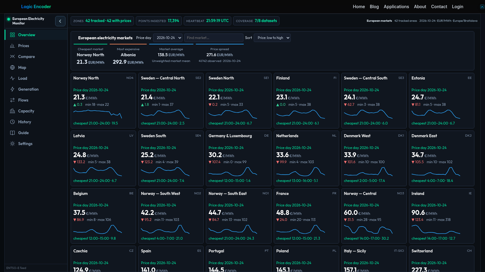

# Power Center — European Electricity Dashboard

Electricity-market information is more useful when prices can be read alongside demand, generation and cross-border activity. Power Center brings these views into one European dashboard, helping users compare markets and understand the context around a price change.

## Tech stack

| Layer | Technologies |
|---|---|
| Core stack | Python; PHP; WordPress; JavaScript; SQLite |

## Compare European markets

Zone cards and market selection make it possible to move between supported countries and bidding areas. Readable market names help users orient themselves before exploring the details. The dashboard uses published ENTSO-E information where it is available.

## Explore prices and history

Price views and heatmaps help compare intervals and recognise patterns over time. A day-and-hour history view provides a broader perspective than the latest value. Published time intervals and available coverage matter when comparing one period with another.

## Connect demand with production

Load views bring actual and forecast demand into the same working context. Generation-mix and forecast information help examine how electricity supply changes across sources. These views support understanding the market rather than presenting price as a standalone signal.

## Review flows and capacity

Cross-border flow views show the available directional information between markets. Capacity comparisons add longer-term context to the generation picture, while imbalance information is available where published. Missing coverage remains important when interpreting a total or comparison.

## Return to the information that matters

Navigation between views keeps the selected market central to the investigation. History and available digest subscription controls support following a market beyond one visit. The practical benefit is a connected view of electricity information that would otherwise require several separate searches.

Explore [Power Center](https://logicencoder.com/european-power-prices/).

---

Private code: [elec-prices-bridge](https://github.com/logicencoder/elec-prices-bridge)

See [REPOS.md](REPOS.md) for related repositories.

**[Logic Encoder](https://logicencoder.com)** · [GitHub](https://github.com/logicencoder) · [Contact](https://logicencoder.com/contact/)
