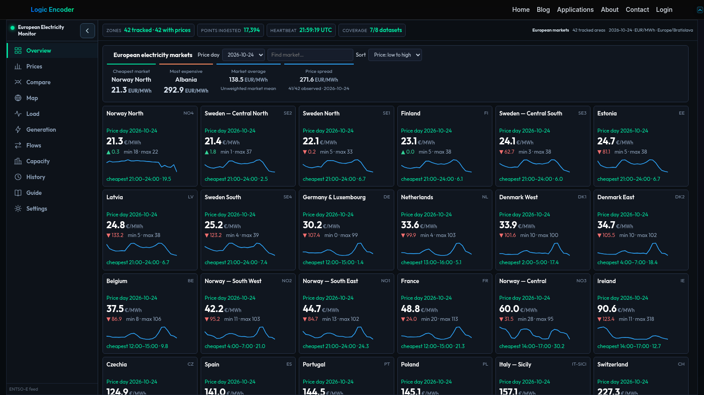

# Power Center — European Electricity Dashboard

Electricity-market information is more useful when prices can be read alongside demand, generation and cross-border activity. Power Center brings these views into one European dashboard, helping users compare markets and understand the context around a price change.

## Tech stack

| Layer | Technologies |
|---|---|
| Core stack | Python; PHP; WordPress; JavaScript; SQLite |

## Compare European markets

The **Overview** shows all tracked bidding zones at a glance: average day-ahead prices, changes against the previous day and the cheapest windows, with chips for how many zones currently return prices and how many of the eight tracked datasets returned data in the last cycle. **Compare** ranks zones and draws multi-zone curves with spread and volatility, and **Map** is a geographic locator with a tile overview of the selected day's prices. Everything comes from the ENTSO-E Transparency Platform where it is published.

Begin with a familiar market or compare several supported areas. Consistent navigation makes it easier to carry a question from the broad European picture into the information available for a particular zone.

## Explore prices and history

**Prices** shows hourly day-ahead prices as a zone-by-hour heatmap, and **History** shows a day-by-hour price heatmap over 14 to 60 days. The native 15-minute prices are averaged into local clock hours, and the cheapest three-hour window of a day is marked. Tomorrow's prices appear after the market publishes them around 13:00 CET.

Price history is useful for reviewing an unusual interval or comparing a day with its surroundings. The heatmap adds a quick way to recognise periods worth examining in more detail.

## Connect demand with production

**Load** compares actual and forecast system load per zone, and **Generation** shows the mix per fuel type with each fuel's share of total output. A total is shown only for the data that was actually published.

Demand and generation help explain the setting in which prices are observed. Keeping these views together lets users investigate the relationship without collecting each series in a separate place.

## Review flows and capacity

**Flows** shows physical cross-border flows and net positions between markets, and **Capacity** shows installed generation capacity per fuel. **Imbalance** shows, for the newest published day, the hourly imbalance settlement price and the total up and down regulation volumes of the selected control area. Only some control areas publish imbalance data, and it appears with a delay, so the view says so when an area has none. Where a zone publishes no data for a view, the page says no verified data is available rather than filling the gap.

Directional flows connect the selected market with its neighbours, and installed capacity gives the longer-term context for the generation mix.

## Return to the information that matters

The **Guide** explains each dataset, unit and term, and **Settings** adjusts colours, font size, density and page size. The page shows the time of the last successful update so the age of every figure is visible.

Explore [Power Center](https://logicencoder.com/european-power-prices/).

A reader can follow one market repeatedly or use the board for a broader comparison. The connected navigation supports both routines without losing the source and period behind each observation.

---

Private code: [elec-prices-bridge](https://github.com/logicencoder/elec-prices-bridge)

See [REPOS.md](REPOS.md) for related repositories.

**[Logic Encoder](https://logicencoder.com)** · [GitHub](https://github.com/logicencoder) · [Contact](https://logicencoder.com/contact/)
